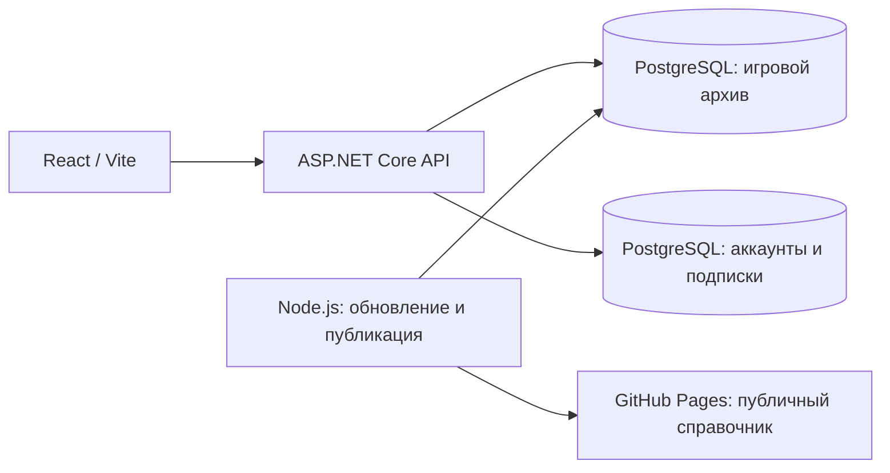

# Направление развития бэкенда

Оценка от 29 октября 2026 года. Это рекомендация для следующего этапа: текущая реализация не перенесена на другой язык.

## Рекомендация

Для будущего публичного API с аккаунтами и подписками выбрать ASP.NET Core. Опыт владельца с C# и EF Core здесь важнее смены языка ради самого языка. Начать с модульного приложения, которое развёртывается как один сервис. React/Vite и PostgreSQL сохранить. Обновление игровых данных и публикацию на Pages сначала оставить существующим Node.js-инструментам.

Для новой реализации подходит .NET 10 LTS: поддержка заявлена до 14 ноября 2028 года. EF Core работает с PostgreSQL через Npgsql; менять СУБД не требуется. [Политика поддержки .NET](https://dotnet.microsoft.com/en-us/platform/support/policy/dotnet-core), [провайдер Npgsql](https://www.npgsql.org/efcore/).

| Вариант                          | Что сохраняется                                         | Что придётся сделать                                                                            | Оценка для проекта                                                                 |
| -------------------------------- | ------------------------------------------------------- | ----------------------------------------------------------------------------------------------- | ---------------------------------------------------------------------------------- |
| Оставить Node.js                 | Один язык с фронтендом, текущие типы, API и инструменты | Полноценные аккаунты, политики доступа, подписки, подготовка API к хостингу                     | Самый короткий путь к первому релизу; технических препятствий для этих функций нет |
| ASP.NET Core для публичного API  | React, PostgreSQL, текущие средства обновления          | Контракты API, слой чтения, Identity/авторизация, новые сущности и развёртывание                | Предпочтительный путь с учётом опыта владельца                                     |
| Python                           | React и PostgreSQL                                      | Аналогичный перенос API, выбор ORM и системы аккаунтов                                          | Пока нет задачи, которая оправдывает ещё одну экосистему вместо знакомой C#        |
| Полностью переписать всё на .NET | Исходные данные и согласованные контракты               | Также парсеры, импорт/экспорт, публикация, восстановление заданий, CLI и проверки совместимости | Шире необходимого на первом этапе                                                  |

Python подходит для такого сайта: Django имеет систему пользователей/прав и ORM, FastAPI поддерживает JWT и различные библиотеки БД. Выбор C# — рекомендация для этого проекта, а не утверждение о неспособности Python или Node.js. [Django authentication](https://docs.djangoproject.com/en/5.2/topics/auth/), [FastAPI JWT](https://fastapi.tiangolo.com/tutorial/security/oauth2-jwt/), [FastAPI SQL](https://fastapi.tiangolo.com/tutorial/sql-databases/).

## Что есть сейчас

- `server/app.ts` — маршруты на `node:http`, с выделенным интерфейсом `ArchiveReader` для чтения данных.
- `server/database/` и `db/migrations/` — PostgreSQL через `pg`, SQL-миграции с контрольными суммами, транзакции и блокировки. EF Core сейчас не используется.
- `server/updates/`, `server/items/`, `server/sync/` — обновление героев/предметов, статистики и публикация согласованного набора данных на Pages.
- `server/index.ts` связывает чтение, обновление, публикацию и частный индекс знаний. Несколько CLI-скриптов и подготовка статической сборки импортируют серверные модули напрямую.
- Локальный токен владельца защищает команды обновления. Это не система аккаунтов посетителей. Пользователей, пользовательских сессий и подписок пока нет.
- Расчёты калькулятора и таблицы выполняются также в браузере через `shared/`; перенос API не требует переписывать их на C#.

Поэтому небольшой HTTP-слой можно заменить раньше, чем весь набор серверных инструментов. Удаление `server/` целиком затронет сборку, CLI и публикацию.

## Первая архитектура

Аккаунты, каталог/механики, пользовательские сборки и подписки можно разделить на модули внутри одного приложения. На первом этапе достаточно одной PostgreSQL с отдельным владением схемами/таблицами. Node и EF не должны независимо мигрировать одни и те же объекты. Архивные таблицы можно сначала читать через отображение существующей схемы или SQL; новые сущности приложения вести через EF Core.

Микросервисы вводить, когда конкретному модулю потребуются отдельное масштабирование, выпуск или изоляция отказов. До этого они добавят сетевые ошибки, отдельные развёртывания, согласование событий и наблюдаемость. Модульное приложение оставляет возможность выделить сервис позднее. [Разделение приложения на логические слои](https://learn.microsoft.com/en-us/dotnet/architecture/modern-web-apps-azure/common-web-application-architectures).

## Аккаунты, JWT и подписка

ASP.NET Core Identity может отвечать за пользователей, хеширование паролей и связанные процессы. Формат сессии/токенов выбирается отдельно: встроенные bearer-токены `MapIdentityApi` **не являются стандартными JWT**. Для стандартных JWT и нескольких API потребуется согласованная OAuth/OIDC-схема выдачи, проверки, обновления и завершения сессий. Встроенный JWT bearer middleware проверяет токены; сам по себе он не заменяет сервер идентификации. [Identity для SPA](https://learn.microsoft.com/en-us/aspnet/core/security/authentication/identity-api-authorization?view=aspnetcore-10.0), [JWT bearer](https://learn.microsoft.com/en-us/aspnet/core/security/authentication/configure-jwt-bearer-authentication?view=aspnetcore-10.0).

Для браузерного сайта стоит сравнить защищённую HttpOnly-cookie с BFF и прямые bearer-запросы из React. Microsoft рекомендует cookie для браузерных приложений; JWT может остаться способом обращения BFF к API. Выбор зависит от будущего домена, клиентов и размещения. При cookie-аутентификации нужна защита от CSRF. Не стоит заранее закреплять хранение долгоживущих токенов в `localStorage`.

Подписка — отдельные серверные сущности и права доступа, а не только `isPremium` в интерфейсе/JWT. Доступ меняется по подтверждённым событиям платёжного провайдера: оплата, продление, отмена и неудачный платёж. Обработчик проверяет подлинность события и не применяет повторное событие второй раз. Stripe здесь служит примером механики, провайдер для проекта ещё не выбран. [События подписок](https://docs.stripe.com/billing/subscriptions/webhooks), [обработка webhook](https://docs.stripe.com/webhooks).

Уже опубликованные JSON остаются публичными: скрытая кнопка или страница не делает их платными. Будущие закрытые операции/данные должны проверять доступ на сервере и не входить в статический пакет.

## Порядок перехода

1. Зафиксировать текущие JSON-контракты, статусы ошибок и проверки совместимости. Объединить настройку адреса API во фронтенде: сейчас герои, предметы и другие ресурсы выбирают адреса отдельно.
2. Поднять ASP.NET Core API чтения рядом с действующим Node, проверить одинаковые ответы на подготовленных данных. Сохранить статический режим справочника и рабочую команду локального запуска.
3. Добавить аккаунты и серверные политики доступа. Сначала довести одну полную цепочку регистрации/входа/выхода и защищённого запроса.
4. Добавить пользовательские сборки/избранное и затем подписку с проверкой событий и прав на сервере.
5. Переносить оставшиеся функции архива только при практической пользе. До нескольких экземпляров обработчика сделать состояние фоновых заданий устойчивым к перезапуску и согласовать конкурирующих исполнителей.
6. Выделять сетевые микросервисы по возникшим требованиям, а не сразу по числу разделов сайта.

При переносе архива сохранить запрет отката данных, отсутствие повторного обновления той же версии, согласованное чтение при экспорте, транзакционные блокировки, точные хеши/байты публикации и восстановление после сбоя. ORM не реализует эти правила автоматически.

GitHub Pages размещает статические HTML/CSS/JS. ASP.NET Core API и PostgreSQL потребуют отдельного хостинга; фронтенд технически может остаться статическим и обращаться к API. Хостинг и платёжный провайдер выбираются отдельным этапом. [Что размещает GitHub Pages](https://docs.github.com/en/pages/getting-started-with-github-pages/what-is-github-pages).
