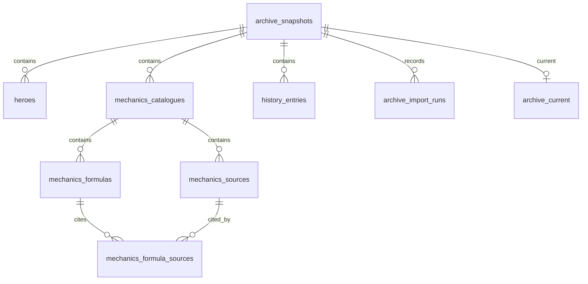

# Локальная база PostgreSQL

PostgreSQL 18 хранит рабочие данные локального Node.js API: героев и их оружие, механики RU/EN, источники и историю снимков. Проверенные файлы `data/` служат форматом обмена и публикации на GitHub Pages. Исследования, решения и профиль остаются в отдельном приватном SQLite-архиве. Браузер получает данные через API; пароль БД ему не передаётся.

## Первый запуск

На настроенном компьютере достаточно `npm run dev`. Команда запускает API и сайт и открывает главную в Chrome. Остановка — `Ctrl+C` в том же терминале. Служба PostgreSQL работает независимо от сайта.

На новом компьютере с установленной PostgreSQL выполни `npm ci`, затем `npm run db:setup` в интерактивном терминале. Команда скрыто запрашивает пароль локального администратора `postgres`, создаёт роль `deadlock_archive_app` без прав суперпользователя, создания БД, управления ролями и репликации. Базы `deadlock_archive` и `deadlock_archive_test` принадлежат этой роли. Случайный пароль приложения записывается только в игнорируемый `.env.local`. Пароль администратора остаётся в памяти на время настройки. Существующие роли, базы и настройки кластера не сбрасываются.

После создания БД применяются миграции и импортируется проверенный пакет данных. Параметр `npm run db:setup -- --no-import` создаёт только роль, базы и конфигурацию. Обычный запуск API заполняет только пустой архив: существующая БД не заменяется файлами при перезапуске.

Конфигурация использует `DEADLOCK_DB_HOST`, `DEADLOCK_DB_PORT`, `DEADLOCK_DB_NAME`, `DEADLOCK_DB_USER`, `DEADLOCK_DB_PASSWORD`. Переменные процесса имеют приоритет над `.env.local`. `DEADLOCK_DB_TEST_NAME` задаёт отдельную тестовую БД и не используется рабочим API. Имена параметров приведены в `.env.example`, реальные пароли туда не добавляются. Неполная конфигурация или недоступная настроенная БД дают явную ошибку; без конфигурации доступен переносимый режим JSON.

## Команды

| Команда                                               | Результат                                                                                                   |
| ----------------------------------------------------- | ----------------------------------------------------------------------------------------------------------- |
| `npm run db:sync -- --dry-run`                        | Проверить совпадение БД, локальных файлов, GitHub и Pages без записи.                                       |
| `npm run db:sync -- --wait`                           | Опубликовать точный снимок БД и дождаться проверки файлов на Pages.                                         |
| `npm run db:status`                                   | Версия текущего снимка и количество записей.                                                                |
| `npm run db:migrate`                                  | Применение SQL-миграций с проверкой контрольных сумм.                                                       |
| `npm run db:import`                                   | Проверка и транзакционный импорт пакета из `data/`. Повтор идентичного импорта не создаёт новый снимок.     |
| `npm run db:query -- status`                          | Краткий статус БД.                                                                                          |
| `npm run db:query -- history`                         | До 20 последних версий.                                                                                     |
| `npm run db:query -- hero "Nurse Harrow"`             | Поиск до 20 текущих героев по имени, адресному имени или варианту написания.                                |
| `npm run db:query -- formula resistance ru`           | Одна формула с объяснением и источниками; также доступен язык `en`.                                         |
| `npm run db:export -- work/database-review/my-export` | Точный экспорт пяти файлов в новую приватную папку для проверки. Существующая папка не перезаписывается.    |
| `npm run db:backup`                                   | Приватная резервная копия в формате `pg_dump --format=custom`.                                              |
| `npm run db:test`                                     | Проверки на настоящем PostgreSQL в отдельной тестовой БД и случайной схеме. Рабочий архив не затрагивается. |

Экспорт не заменяет `data/`, не обновляет приватный индекс и не публикует сайт. Команда `db:query` принимает только перечисленные виды запросов, ограничивает число результатов и не выполняет произвольный SQL из аргументов.

## Обновление и публикация

PostgreSQL — источник текущего публичного снимка. В локальном центре есть две независимые операции:

- **«Обновить данные»** проверяет новый патч и импортирует его в БД. При совпадении клиента операция ничего не перезаписывает. При включённой публикации итоговый снимок автоматически передаётся тому же механизму синхронизации.
- **«Синхронизировать с Pages»** отправляет текущее содержимое БД, включая изменения характеристик, формул, переводов и истории внутри одной версии клиента. Отдельная проверка синхронизации ничего не публикует.

Снимок читается в транзакции `REPEATABLE READ READ ONLY`. Для пяти JSON и портретов рассчитываются контрольные суммы; `data/snapshot-manifest.json` связывает все публичные файлы в один снимок. Локальный экспорт создаёт резервные копии и откатывается при сбое записи. Затем через GitHub API создаётся один коммит только разрешённых данных и портретов. Код, пароли, БД и приватные исследования туда не добавляются. Actions собирает этот коммит без повторного получения игровых данных.

Статус очереди означает только ожидание. Успех подтверждается сравнением манифеста и фактических байтов файлов на Pages. Если БД, локальные файлы, GitHub и Pages уже совпадают, новый коммит и сборка не создаются. При сбое можно повторить синхронизацию: незавершённая задача сохраняется в приватной `work/sync-state.json`, а неудачная сборка повторяется без нового коммита данных. Перед развёртыванием проверяется текущий `main`, чтобы устаревший повтор не откатил сайт.

```sh
npm run db:sync -- --dry-run
npm run db:sync
npm run db:sync -- --wait
```

Первая команда только сравнивает. Вторая запускает публикацию и возвращает её состояние. Третья ждёт проверенного развёртывания до десяти минут; её можно использовать и после перезапуска для проверки ранее отправленной задачи. При более новой версии данных на GitHub или конкурентном изменении ветки автоматической перезаписи нет: сначала нужно разобраться с расхождением.

Сохранение JSON, импорт PostgreSQL, приватная индексация, коммит GitHub и развёртывание учитываются отдельно. Ошибка импорта оставляет предыдущий текущий снимок БД; сохранённые новые файлы можно повторно импортировать. `db:import` помогает восстановить локальную синхронизацию, `db:sync` публикует рабочую БД. Сбой GitHub или Pages не удаляет локальные данные. Команда `db:export` по-прежнему создаёт только отдельную папку для проверки.

Герои могут обновиться раньше проверки механик: формулы сохраняют настоящую дату и версию сверки, с предупреждением об устаревании. GitHub Pages остаётся статическим сайтом и не подключается к PostgreSQL напрямую. Прямые SQL-правки не публикуются фоновым наблюдателем: после завершения правок нажми синхронизацию. Работающий ПК нужен для отправки данных, но не для просмотра уже опубликованного сайта друзьями.

Синхронизация создаёт коммит на GitHub. Локальная ветка Git автоматически не переключается: перед дальнейшей разработкой проверь `git status`, получи изменения `git fetch` и согласуй рабочие файлы с `origin/main`. Не используй принудительный сброс незавершённой работы.

## Схема

Миграции находятся в `db/migrations/`. `archive_current` указывает на один полный снимок. Импорт записывает снимок и связанные строки одной транзакцией, затем переключает указатель. Старые снимки сохраняются для сравнения и истории.



У героев отдельно записаны числовые характеристики, параметры оружия и происхождение значений. Каталоги механик содержат тексты RU/EN, источники и связи формул с источниками. Метаданные и происхождение относятся к снимку; `history_entries` хранит историю опубликованных в архиве версий. Примеры запросов только для чтения — в `db/examples.sql`.

Миграция `002_history_patch.sql` добавляет необязательное поле `history_entries.patch` (JSONB). Оно хранит проверенную ссылку на сборку SteamDB или ревизию GameTracking, исходный коммит, Steam Build ID, дату проверки и состояние описания. Заголовок и краткое описание RU/EN необязательны. Старые строки сохраняются с NULL; импорт, локальный API, экспорт и публикация передают сведения без потерь. Адреса проверяются по источнику и идентификатору; произвольный HTML не исполняется. Для нового клиента запись обновления автоматически связывается с той же проверенной ревизией, а совпадение текущего клиента сохраняет прежний режим без изменений.

## VS Code

Установлено расширение Microsoft **PostgreSQL** (`ms-ossdata.vscode-pgsql`); оно также рекомендовано в настройках проекта. Для подключения открой панель PostgreSQL → добавление подключения и укажи:

- Сервер: `127.0.0.1`, порт: `5432`.
- База: `deadlock_archive`.
- Пользователь: `deadlock_archive_app`.
- Пароль приложения: значение `DEADLOCK_DB_PASSWORD` из приватного `.env.local`.

Введи пароль в диалоге расширения и используй его защищённое хранилище. Не добавляй пароль, строку подключения или учётные данные администратора в настройки проекта и SQL-файлы. Расширение не требуется для работы сайта и команд npm.

## Резервные копии и восстановление

`npm run db:backup` сохраняет файл в игнорируемой папке `work/backups/postgresql/`. Пароль передаётся `pg_dump` через окружение дочернего процесса, без аргумента командной строки. Посмотреть состав копии можно командой `pg_restore --list <путь-к-копии>`.

Восстановление сначала проверяют в **отдельной** базе. Администратор создаёт новую `deadlock_archive_verify`, принадлежащую `deadlock_archive_app`, затем выполняется:

```sh
pg_restore --no-owner --no-acl --dbname=deadlock_archive_verify --username=deadlock_archive_app --host=127.0.0.1 --port=5432 --password <путь-к-копии>
```

Клиент запросит пароль приложения. Не используй `--clean` против рабочего архива. Проверочная копия не изменяет `deadlock_archive` и публичные файлы. На Windows утилиты находятся в `C:\Program Files\PostgreSQL\18\bin`, если эта папка не добавлена в PATH.

При проблемах начни с `npm run db:status`. Если пароль приложения потерян, `db:setup` не сбрасывает существующую роль: потребуется отдельно восстановить конфигурацию. Для контекста исследований по-прежнему используется `npm run knowledge -- status`, для числовых расчётов — проверенный модуль `shared/mechanics.ts` или калькулятор сайта с его допущениями.

# Item catalogues

Migration `003_items.sql` adds catalogue metadata, ordered shop-item rows and ordered purchase-statistics rows scoped to each archive version. Nested localized attributes and hero purchase aggregates retain their original JSON values. Older versions without items export without adding item fields; items and statistics must always be imported together and match the hero client version.

`GET /api/items` and `GET /api/item-statistics` read PostgreSQL when configured. A version with no item catalogue returns 404; database failures return 503. File mode reads the curated bundle. `npm run db:query -- item "NAME"` returns at most20 matching items. `db:export` includes both JSON files when the selected version contains them.

Initial catalog generation is explicit: take a private backup, run `npm run items:refresh -- --dry-run`, then `npm run items:refresh`. With configured PostgreSQL the command preserves database companion data and imports the complete validated bundle; it reports file/database outcomes separately and does not publish. Server startup preserves an existing database. New game versions stage heroes and items together before committing files, importing the database and publishing; a same-client game update remains a no-op. Explicit `db:sync` compares content hashes, including item JSON and referenced local WebP icons. See [items.md](items.md).

Exact synchronization approves only the existing curated JSON, the paired `data/items.json` / `data/item-statistics.json`, hero portraits and `public/assets/items/*.webp`. The total file cap is512; per-file and total-byte caps remain4MiB and32MiB. Legacy remote manifests remain readable so the first item publication can upgrade an older deployment. Publication still verifies every approved file byte.
