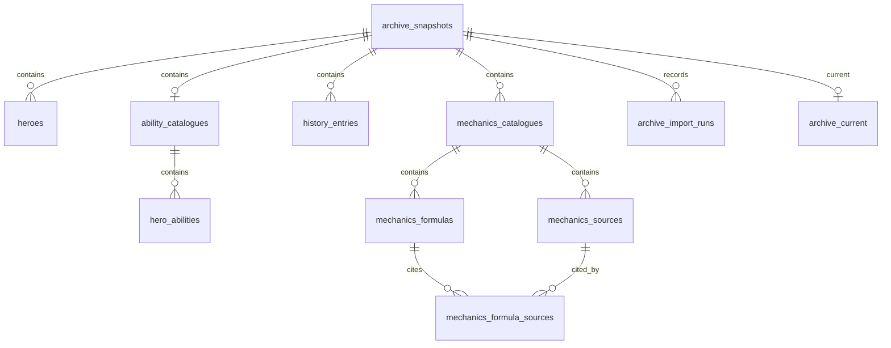

# Локальная база PostgreSQL

PostgreSQL 18 хранит рабочие данные локального ASP.NET Core 10 API (EF Core 10/Npgsql): героев и их оружие, механики RU/EN, источники и историю снимков. Проверенные файлы `data/` служат форматом обмена и публикации на GitHub Pages. Исследования, решения и профиль остаются в отдельном приватном SQLite-архиве. Браузер получает данные через API; пароль БД ему не передаётся.

## Первый запуск

Для backend нужен .NET SDK 10; Node.js 24.15+ нужен Vite, npm-запускам и приватному SQLite-инструментарию. На настроенном компьютере достаточно `npm run dev`. Команда запускает API и сайт и открывает главную в Chrome. Остановка — `Ctrl+C` в том же терминале. Служба PostgreSQL работает независимо от сайта.

На новом компьютере с установленной PostgreSQL выполни `npm ci`, затем `npm run db:setup` в интерактивном терминале. Команда скрыто запрашивает пароль локального администратора `postgres`, создаёт роль `deadlock_archive_app` без прав суперпользователя, создания БД, управления ролями и репликации. Базы `deadlock_archive` и `deadlock_archive_test` принадлежат этой роли. Случайный пароль приложения записывается только в игнорируемый `.env.local`. Пароль администратора остаётся в памяти на время настройки. Существующие роли, базы и настройки кластера не сбрасываются.

После создания БД применяются миграции и импортируется проверенный пакет данных. Параметр `npm run db:setup -- --no-import` создаёт только роль, базы и конфигурацию. Обычный запуск API заполняет только пустой архив: существующая БД не заменяется файлами при перезапуске. Сохранённая версия доступна до фоновой проверки обновлений. При настроенной БД эта проверка по умолчанию публикует изменения. `DEADLOCK_AUTO_UPDATE=0` отключает стартовую проверку, `DEADLOCK_AUTO_PUBLISH=0` — её автоматическую публикацию. См. [backend.md](backend.md).

Конфигурация использует `DEADLOCK_DB_HOST`, `DEADLOCK_DB_PORT`, `DEADLOCK_DB_NAME`, `DEADLOCK_DB_USER`, `DEADLOCK_DB_PASSWORD`. Переменные процесса имеют приоритет над `.env.local`. `DEADLOCK_DB_TEST_NAME` задаёт отдельную тестовую БД и не используется рабочим API. Имена параметров приведены в `.env.example`, реальные пароли туда не добавляются. Неполная конфигурация или недоступная настроенная БД дают явную ошибку; без конфигурации доступен переносимый режим JSON.

## Команды

| Команда                                               | Результат                                                                                                   |
| ----------------------------------------------------- | ----------------------------------------------------------------------------------------------------------- |
| `npm run db:sync -- --dry-run`                        | Проверить совпадение БД, локальных файлов, GitHub и Pages без изменения публичных файлов, БД и публикации.  |
| `npm run db:sync -- --wait`                           | Опубликовать точный снимок БД и дождаться проверки файлов на Pages.                                         |
| `npm run db:status`                                   | Версия текущего снимка и количество записей.                                                                |
| `npm run db:migrate`                                  | Применение SQL-миграций с проверкой контрольных сумм.                                                       |
| `npm run db:import`                                   | Проверка и транзакционный импорт пакета из `data/`. Повтор идентичного импорта не создаёт новый снимок.     |
| `npm run db:query -- item "Healing"`                  | Поиск до 20 предметов.                                                                                      |
| `npm run db:query -- hero "Nurse Harrow"`             | Поиск до 20 текущих героев по имени, адресному имени или варианту написания.                                |
| `npm run db:query -- formula resistance ru`           | Одна формула с объяснением и источниками; также доступен язык `en`.                                         |
| `npm run db:export -- work/database-review/my-export` | Экспорт полного пакета JSON в новую приватную папку для проверки. Существующая папка не перезаписывается.   |
| `npm run db:backup`                                   | Приватная резервная копия в формате `pg_dump --format=custom`.                                              |
| `npm run db:test`                                     | Проверки на настоящем PostgreSQL в отдельной тестовой БД и случайной схеме. Рабочий архив не затрагивается. |

Экспорт не заменяет `data/`, не обновляет приватный индекс и не публикует сайт. Команда `db:query` принимает только перечисленные виды запросов, ограничивает число результатов и не выполняет произвольный SQL из аргументов.

## Обновление и публикация

PostgreSQL — источник текущего публичного снимка. В локальном центре есть две независимые операции:

- **«Обновить данные»** проверяет новый патч и импортирует его в БД. При совпадении клиента игровые assets не загружаются повторно; независимое получение официальных описаний патчей может сохранить изменения истории. При включённой публикации итоговый снимок автоматически передаётся тому же механизму синхронизации.
- **«Синхронизировать с Pages»** отправляет текущее содержимое БД, включая изменения характеристик, формул, переводов и истории внутри одной версии клиента. Отдельная проверка синхронизации ничего не публикует.

Снимок читается в транзакции `REPEATABLE READ READ ONLY`. Для публичных JSON, портретов и иконок предметов рассчитываются контрольные суммы; `data/snapshot-manifest.json` связывает все публичные файлы в один снимок. Локальный экспорт создаёт резервные копии и откатывается при сбое записи. Затем через GitHub API создаётся один коммит только разрешённых данных и портретов. Код, пароли, БД и приватные исследования туда не добавляются. Actions собирает этот коммит без повторного получения игровых данных.

Статус очереди означает только ожидание. Успех подтверждается сравнением манифеста и фактических байтов файлов на Pages. Если БД, локальные файлы, GitHub и Pages уже совпадают, новый коммит и сборка не создаются. При сбое можно повторить синхронизацию: незавершённая задача сохраняется в приватной `work/sync-state.json`, а неудачная сборка повторяется без нового коммита данных. Перед развёртыванием проверяется текущий `main`, чтобы устаревший повтор не откатил сайт.

```sh
npm run db:sync -- --dry-run
npm run db:sync
npm run db:sync -- --wait
```

Первая команда только сравнивает. Вторая запускает публикацию и возвращает её состояние. Третья ждёт проверенного развёртывания до десяти минут; её можно использовать и после перезапуска для проверки ранее отправленной задачи. При более новой версии данных на GitHub или конкурентном изменении ветки автоматической перезаписи нет: сначала нужно разобраться с расхождением.

Сохранение JSON, импорт PostgreSQL, приватная индексация, коммит GitHub и развёртывание учитываются отдельно. Ошибка импорта оставляет предыдущий текущий снимок БД; сохранённые новые файлы можно повторно импортировать. `db:import` помогает восстановить локальную синхронизацию, `db:sync` публикует рабочую БД. Сбой GitHub или Pages не удаляет локальные данные. Команда `db:export` по-прежнему создаёт только отдельную папку для проверки.

Герои могут обновиться раньше проверки механик: формулы сохраняют настоящую дату и версию сверки, с предупреждением об устаревании. GitHub Pages остаётся статическим сайтом и не подключается к PostgreSQL напрямую. Прямые SQL-правки не публикуются фоновым наблюдателем: после завершения правок нажми синхронизацию. Работающий ПК нужен для отправки данных, но не для просмотра уже опубликованного сайта друзьями.

Синхронизация создаёт коммит на GitHub. Локальная ветка Git автоматически не переключается: перед дальнейшей разработкой проверь `git status`, получи изменения `git fetch` и согласуй рабочие файлы с `origin/main`. Не используй принудительный сброс незавершённой работы.

## Схема

Доступ реализован в `backend/Deadlock.Api/Data/`: EF Core сопоставляет метаданные и указатель текущей версии, Npgsql выполняет совместимые реляционные операции в транзакциях. Миграции находятся в `db/migrations/`. `archive_current` указывает на один полный снимок. Импорт записывает снимок и связанные строки одной транзакцией, затем переключает указатель. Старые снимки сохраняются для сравнения и истории.



У героев отдельно записаны числовые характеристики, параметры оружия и происхождение значений. Каталоги механик содержат тексты RU/EN, источники и связи формул с источниками. Метаданные и происхождение относятся к снимку; `history_entries` хранит историю опубликованных в архиве версий. Примеры запросов только для чтения — в `db/examples.sql`.

Миграция `004_calculator_metadata.sql` добавляет необязательные JSONB-поля `archive_snapshots.calculator_rules` и `heroes.calculation`. Правила инвентаря и вложений, а также дополнительные характеристики героев читаются из этих столбцов и сохраняются при экспорте и восстановлении без `archive_bundle_payloads`. Миграция переносит уже сохранённые сведения из дополнительных пакетов для всех версий архива. У старых версий без этих полей остаётся SQL NULL; экспорт не добавляет пустые поля. Перед применением к рабочей БД выполни `npm run db:backup`, затем `npm run db:migrate`; миграция не обновляет игровые данные и не публикует сайт.

Миграция `005_hero_abilities.sql` добавляет необязательный каталог способностей: `ability_catalogues` хранит версию и происхождение, `hero_abilities` — четыре упорядоченных умения каждого героя с локализованными описаниями, секциями, параметрами, функциями масштабирования, тремя улучшениями и связанными вариантами. Сохраняются исходные условия показа и отключённые функции; каталог не означает проверку формул в движке. Эти таблицы полностью восстанавливают `abilities.json` без `archive_bundle_payloads`; миграция переносит уже сохранённые каталоги всех версий, сохраняя текущий указатель. Старые версии без каталога остаются без него.

`GET /api/abilities` возвращает отдельный каталог или 404 для старого архива; `/api/heroes` его не включает. `db:export` добавляет `abilities.json`, только когда каталог сохранён. Проверяются полный состав героев, точные слоты 1–4, версия источников, улучшения и безопасный текст. Плановое обновление нового клиента создаёт каталог атомарно с героями, предметами и статистикой; проверка того же клиента по-прежнему не загружает игровые данные. Первое обогащение той же версии требует обычного явного обновления после backup и dry-run. Публикация передаёт только каталог и используемые `public/assets/abilities/*.webp` в пределах общих ограничений manifest (512 файлов, 4 МиБ на файл, 32 МиБ суммарно); исходный API и raw-конфигурация остаются приватными.

Миграция `002_history_patch.sql` добавляет необязательное поле `history_entries.patch` (JSONB). Оно хранит проверенную ссылку на сборку SteamDB или ревизию GameTracking, исходный коммит, Steam Build ID, дату проверки и состояние описания. Заголовок и краткое описание RU/EN необязательны. Старые строки сохраняются с NULL; импорт, локальный API, экспорт и публикация передают сведения без потерь. Адреса проверяются по источнику и идентификатору; произвольный HTML не исполняется. Для нового клиента запись обновления автоматически связывается с той же проверенной ревизией, а совпадение текущего клиента не требует повторной загрузки игровых assets.

## VS Code

В настройках проекта рекомендовано расширение Microsoft **PostgreSQL** (`ms-ossdata.vscode-pgsql`). Для C# backend рекомендовано `ms-dotnettools.csharp`. Рекомендация не означает, что расширения уже установлены. Для подключения открой панель PostgreSQL → добавление подключения и укажи:

- Сервер: `127.0.0.1`, порт: `5432`.
- База: `deadlock_archive`.
- Пользователь: `deadlock_archive_app`.
- Пароль приложения: значение `DEADLOCK_DB_PASSWORD` из приватного `.env.local`.

Введи пароль в диалоге расширения и используй его защищённое хранилище. Не добавляй пароль, строку подключения или учётные данные администратора в настройки проекта и SQL-файлы. Расширение не требуется для работы сайта и команд npm.

## Резервные копии и восстановление

`npm run db:backup` сохраняет файл в игнорируемой папке `work/backups/postgresql/`. Пароль передаётся `pg_dump` через окружение дочернего процесса, без аргумента командной строки. Посмотреть состав копии можно командой `pg_restore --list <путь-к-копии>`.

Восстановление сначала проверяют в **отдельной** базе. Администратор создаёт новую `deadlock_archive_verify`, принадлежащую `deadlock_archive_app`, затем выполняется:

```sh
pg_restore --no-owner --no-acl --dbname=deadlock_archive_verify --username=deadlock_archive_app --host=127.0.0.1 --port=5432 --password <путь-к-копии>
```

Клиент запросит пароль приложения. Не используй `--clean` против рабочего архива. Проверочная копия не изменяет `deadlock_archive` и публичные файлы. На Windows утилиты находятся в `C:\Program Files\PostgreSQL\18\bin`, если эта папка не добавлена в PATH.

При проблемах начни с `npm run db:status`. Если пароль приложения потерян, `db:setup` не сбрасывает существующую роль: потребуется отдельно восстановить конфигурацию. Для контекста исследований по-прежнему используется `npm run knowledge -- status`, для числовых расчётов — проверенный модуль `shared/mechanics.ts` или калькулятор сайта с его допущениями.

## Предметы и официальная история

Миграция `003_items.sql` добавляет каталог предметов и статистику покупок для каждой версии архива. Предметы и статистика импортируются парой и должны соответствовать клиенту героев. Версии без каталога продолжают читаться; API возвращает 404 для отсутствующего каталога. Экспорт включает оба JSON, когда они есть.

`history.versions` и `history_entries` хранят версии клиента, даты и происхождение конкретных сборок. Отдельный `history.patches` хранит официальные описания Steam по news GID; GID не является номером клиента или Steam Build ID. Связь с клиентом не выводится из близости дат. Дополнительный `archive_bundle_payloads` сохраняет полный пакет, включая эти поля и будущие расширения; значения существующих реляционных строк остаются приоритетными при чтении. Старт не перезаписывает существующую БД публичным JSON.

Перед явным обновлением предметов сохрани резервную копию и выполни `npm run items:refresh -- --dry-run`, затем `npm run items:refresh`. Команда обновляет предметы и статистику согласованно; обычная проверка игры сохраняет same-client asset no-op. Подготовка dry-run может создать приватный кандидат/кеш, но не меняет публичные файлы, БД или GitHub. Подробнее — [items.md](items.md).

Точная синхронизация включает публичные JSON, портреты и `public/assets/items/*.webp`; ограничение — 512 файлов, 4 MiB на файл и 32 MiB суммарно. Исследования, конфигурация и dumps не входят в пакет. Публикация проверяет байты каждого разрешённого файла.
