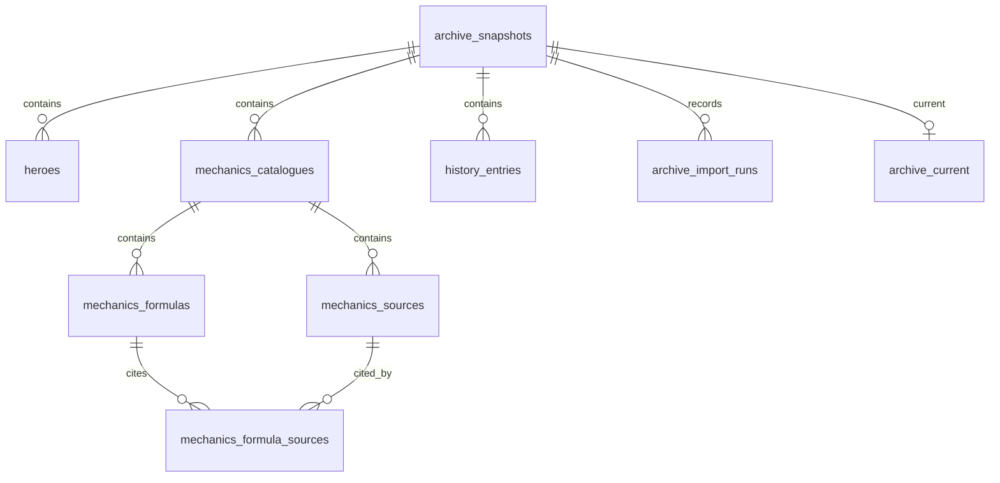

# Локальная база PostgreSQL

PostgreSQL 18 хранит рабочие данные локального Node.js API: героев и их оружие, механики RU/EN, источники и историю снимков. Проверенные файлы `data/` служат форматом обмена и публикации на GitHub Pages. Исследования, решения и профиль остаются в отдельном приватном SQLite-архиве. Браузер получает данные через API; пароль БД ему не передаётся.

## Первый запуск

На настроенном компьютере достаточно `npm run dev`. Команда запускает API и сайт и открывает главную в Chrome. Остановка — `Ctrl+C` в том же терминале. Служба PostgreSQL работает независимо от сайта.

На новом компьютере с установленной PostgreSQL выполни `npm ci`, затем `npm run db:setup` в интерактивном терминале. Команда скрыто запрашивает пароль локального администратора `postgres`, создаёт роль `deadlock_archive_app` без прав суперпользователя, создания БД, управления ролями и репликации. Базы `deadlock_archive` и `deadlock_archive_test` принадлежат этой роли. Случайный пароль приложения записывается только в игнорируемый `.env.local`. Пароль администратора остаётся в памяти на время настройки. Существующие роли, базы и настройки кластера не сбрасываются.

После создания БД применяются миграции и импортируется проверенный пакет данных. Параметр `npm run db:setup -- --no-import` создаёт только роль, базы и конфигурацию. Обычный запуск API заполняет только пустой архив: существующая БД не заменяется файлами при перезапуске.

Конфигурация использует `DEADLOCK_DB_HOST`, `DEADLOCK_DB_PORT`, `DEADLOCK_DB_NAME`, `DEADLOCK_DB_USER`, `DEADLOCK_DB_PASSWORD`. Переменные процесса имеют приоритет над `.env.local`. `DEADLOCK_DB_TEST_NAME` задаёт отдельную тестовую БД и не используется рабочим API. Имена параметров приведены в `.env.example`, реальные пароли туда не добавляются. Неполная конфигурация или недоступная настроенная БД дают явную ошибку; без конфигурации доступен переносимый режим JSON.

## Команды

| Команда                                               | Результат                                                                                                   |
| ----------------------------------------------------- | ----------------------------------------------------------------------------------------------------------- |
| `npm run db:status`                                   | Версия текущего снимка и количество записей.                                                                |
| `npm run db:migrate`                                  | Применение SQL-миграций с проверкой контрольных сумм.                                                       |
| `npm run db:import`                                   | Проверка и транзакционный импорт пакета из `data/`. Повтор идентичного импорта не создаёт новый снимок.     |
| `npm run db:query -- status`                          | Краткий статус БД.                                                                                          |
| `npm run db:query -- history`                         | До 20 последних версий.                                                                                     |
| `npm run db:query -- hero "Nurse Harrow"`             | Поиск до 20 текущих героев по имени, адресному имени или варианту написания.                                |
| `npm run db:query -- formula resistance ru`           | Одна формула с объяснением и источниками; также доступен язык `en`.                                         |
| `npm run db:export -- work/database-review/my-export` | Точный экспорт пяти файлов в новую приватную папку для проверки. Существующая папка не перезаписывается.    |
| `npm run db:backup`                                   | Приватная резервная копия в формате `pg_dump --format=custom`.                                              |
| `npm run db:test`                                     | Проверки на настоящем PostgreSQL в отдельной тестовой БД и случайной схеме. Рабочий архив не затрагивается. |

Экспорт не заменяет `data/`, не обновляет приватный индекс и не публикует сайт. Команда `db:query` принимает только перечисленные виды запросов, ограничивает число результатов и не выполняет произвольный SQL из аргументов.

## Обновление и публикация

В локальном центре обновлений порядок такой: сверка версии → проверка и сохранение JSON → транзакционный импорт PostgreSQL → приватный индекс → отправка публикации. Если клиент уже актуален, полное обновление, импорт и GitHub Actions не запускаются.

При сбое импорта PostgreSQL сохраняет предыдущий текущий снимок. Новые JSON остаются на диске, индекс и публикация не запускаются. После восстановления подключения можно повторить кнопку: она импортирует уже сохранённые новые файлы. Для отдельного восстановления синхронизации после проверки файлов существует `npm run db:import`. Результаты сохранения JSON, импорта БД, индексации и публикации учитываются раздельно.

Герои могут обновиться раньше проверки механик. В таком случае формулы сохраняют реальную версию последней сверки и предупреждение об устаревании. Автоматически приписывать им новый патч нельзя.

GitHub Pages запускает статический сайт с опубликованным JSON. Локальная PostgreSQL не становится доступна друзьям и не требуется для открытия публичного сайта. Изменение записей через SQL само по себе ничего не публикует: сначала нужен проверенный экспорт и перенос публичных изменений в `data/`.

## Схема

Миграции находятся в `db/migrations/`. `archive_current` указывает на один полный снимок. Импорт записывает снимок и связанные строки одной транзакцией, затем переключает указатель. Старые снимки сохраняются для сравнения и истории.



У героев отдельно записаны числовые характеристики, параметры оружия и происхождение значений. Каталоги механик содержат тексты RU/EN, источники и связи формул с источниками. Метаданные и происхождение относятся к снимку; `history_entries` хранит историю опубликованных в архиве версий. Примеры запросов только для чтения — в `db/examples.sql`.

## VS Code

Установлено расширение Microsoft **PostgreSQL** (`ms-ossdata.vscode-pgsql`); оно также рекомендовано в настройках проекта. Для подключения открой панель PostgreSQL → добавление подключения и укажи:

- Сервер: `127.0.0.1`, порт: `5432`.
- База: `deadlock_archive`.
- Пользователь: `deadlock_archive_app`.
- Пароль приложения: значение `DEADLOCK_DB_PASSWORD` из приватного `.env.local`.

Введи пароль в диалоге расширения и используй его защищённое хранилище. Не добавляй пароль, строку подключения или учётные данные администратора в настройки проекта и SQL-файлы. Расширение не требуется для работы сайта и команд npm.

## Резервные копии и восстановление

`npm run db:backup` сохраняет файл в игнорируемой папке `work/backups/postgresql/`. Пароль передаётся `pg_dump` через окружение дочернего процесса, без аргумента командной строки. Посмотреть состав копии можно командой `pg_restore --list <путь-к-копии>`.

Восстановление сначала проверяют в **отдельной** базе. Администратор создаёт новую `deadlock_archive_verify`, принадлежащую `deadlock_archive_app`, затем выполняется:

```sh
pg_restore --no-owner --no-acl --dbname=deadlock_archive_verify --username=deadlock_archive_app --host=127.0.0.1 --port=5432 --password <путь-к-копии>
```

Клиент запросит пароль приложения. Не используй `--clean` против рабочего архива. Проверочная копия не изменяет `deadlock_archive` и публичные файлы. На Windows утилиты находятся в `C:\Program Files\PostgreSQL\18\bin`, если эта папка не добавлена в PATH.

При проблемах начни с `npm run db:status`. Если пароль приложения потерян, `db:setup` не сбрасывает существующую роль: потребуется отдельно восстановить конфигурацию. Для контекста исследований по-прежнему используется `npm run knowledge -- status`, для числовых расчётов — проверенный модуль `shared/mechanics.ts` или калькулятор сайта с его допущениями.
